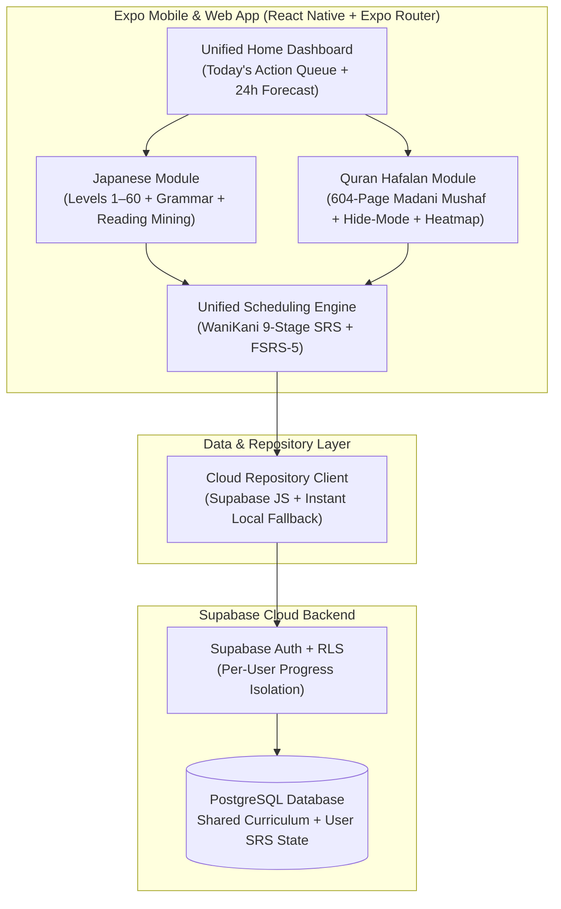

# Aimprove — All-in-One Learning System Implementation Plan

An intentional, mobile-first learning sanctuary built with **React Native + Expo (TypeScript)** and **Supabase (PostgreSQL + Auth + RLS)**, designed around a **Calm Study Sanctuary** aesthetic (Warm Paper Light & Deep Ink Dark modes).

---

## 1. System Decisions Summary

| Area | Decision |
| :--- | :--- |
| **Platform** | Mobile-first native/hybrid app using **React Native + Expo (TypeScript)** with Web preview support |
| **Backend & Storage** | **Cloud-only backend** powered by **Supabase** (PostgreSQL + Supabase Auth + RLS), plus a local fallback provider for immediate zero-config development |
| **App Structure** | **Unified Daily Hub + Dedicated Domain Modules** (Home Action Queue + Japanese Module + Quran Hafalan Module) |
| **Home Dashboard** | Focused on **Today's Action Queue** (One-tap cards for due Japanese Lessons/Reviews and today's Quran Sabaq/Sabqi/Manzil pages) + **24-Hour Review Forecast Timeline** |
| **Japanese Curriculum** | **WaniKani-style Progressive Levels (Levels 1–60)** stored in standalone Supabase tables (Radicals unlock Kanji → Kanji unlock Vocab & Next Level) + **JLPT N5–N1 Grammar Reference & Cloze Drills** + **Reading Passages with 1-Tap Sentence Mining** |
| **Japanese Review Style** | **Strict Typed Input** (WaniKani / Bunpro style) — built-in Romaji-to-Kana IME for Readings and fuzzy typo-tolerant matching for English Meanings |
| **Quran Tracking Unit** | **Strictly Mushaf Page-based** (Pages 1–604 standard 15-line Madani Mushaf) |
| **Quran Reader & Testing** | **Authentic 15-line Madani Mushaf Page view + Interactive Ayah/Word layer** with Hide-Mode (blur/hide words or ayahs, tap to reveal/mark hesitation) + optional translation sheet |
| **Quran Revision Lifecycle** | **Automated Lifecycle + SRS** — New pages start as **Sabaq** (daily), automatically graduate to **Sabqi** (recent 7–20 pages reviewed daily), then enter **Manzil** (**FSRS** spaced intervals calculated from recitation mistakes/peeks) + **604-Page / 30-Juz Mastery Heatmap** |
| **SRS Algorithms** | **Domain-Tailored SRS under a Unified Queue** — WaniKani 9-stage SRS (`Apprentice I–IV`, `Guru I–II`, `Master`, `Enlightened`, `Burned`) for Japanese; `Sabaq → Sabqi → FSRS-5 Manzil` for Quran |
| **Authentication** | **Personal Account with Supabase Auth (Email/Password) + RLS** — private per-user progress tables paired with a shared read-only curriculum database |
| **Visual Aesthetic** | **Calm Study Sanctuary** — Warm Paper Light (`#FAF7F2`) & Deep Ink Dark (`#111318`) modes, high-contrast editorial typography for Japanese Kanji/Kana & Arabic Uthmani script, subtle domain accents (Indigo/Crimson for Japanese, Emerald/Gold for Quran) |

---

## 2. System Architecture



---

## 3. Core Modules & Workflows

### A. Unified Home Hub (`app/(tabs)/index.tsx`)
Focused exclusively on **Today's Action Queue** without visual bloat:
- **Japanese Queue Card**:
  - Available **Lessons** count (unlocked via current Level 1–60 progression) with 1-tap launch.
  - Due **Reviews** count across Radicals, Kanji, Vocab, Grammar, and Mined cards.
- **Quran Hafalan Queue Card**:
  - **Sabaq** (Today's New Page target), **Sabqi** (Recent memorized pages in the rolling 7–20 day window), and **Manzil** (Due FSRS revision pages).
- **24-Hour Review Forecast Timeline**:
  - Hour-by-hour bar breakdown showing incoming Japanese SRS items and Quran revision pages over the next 24 hours.

---

### B. Japanese Learning Module (`app/(tabs)/japanese/`)
1. **WaniKani-Style Progressive Levels (Levels 1–60)**:
   - **9-Stage SRS**:
     - `Stage 0`: Locked / Lesson Queue
     - `Stage 1`: Apprentice I (+4 hours)
     - `Stage 2`: Apprentice II (+8 hours)
     - `Stage 3`: Apprentice III (+23 hours)
     - `Stage 4`: Apprentice IV (+47 hours)
     - `Stage 5`: Guru I (+1 week) — *Unlocks dependent Kanji/Vocab/Level!*
     - `Stage 6`: Guru II (+2 weeks)
     - `Stage 7`: Master (+1 month)
     - `Stage 8`: Enlightened (+4 months)
     - `Stage 9`: Burned (Complete)
   - **Dependency Unlocking**: Reaching **Guru I** on a level's Radicals unlocks its dependent Kanji; reaching **Guru I** on 90% of a level's Kanji unlocks the next Level and dependent Vocabulary.
   - **Penalty Calculation**: Incorrect answers drop the item's SRS stage using WaniKani's formula:
     $$\text{New Stage} = \max\left(1, \text{Current Stage} - \left\lceil \frac{\text{Incorrect Count}}{2} \right\rceil \times \text{Penalty Factor}\right)$$
     where $\text{Penalty Factor} = 2$ if $\text{Current Stage} \ge 5$ (Guru+), else $1$.
2. **Strict Typed Input Review Engine (`app/japanese/review.tsx`)**:
   - Built-in **WanaKana-style real-time Romaji-to-Kana IME** (`ka` → `か`, `shi` → `し`, `nn` → `ん`, `tte` → `って`) when answering **Reading** prompts.
   - Levenshtein fuzzy typo tolerance for English **Meaning** prompts.
   - Rich expandable item sheet after answering: mnemonic story, radical composition, pitch accent pattern, and context sentences.
3. **Grammar Reference & Cloze Drills (`app/japanese/grammar.tsx`)**:
   - Structured JLPT N5–N1 grammar points integrated into the typed review queue via fill-in-the-blank (cloze) Japanese input sentences with nuance/hint prompts.
4. **Reading Passages & 1-Tap Sentence Mining (`app/japanese/reading.tsx`)**:
   - Level-matched short stories and essays.
   - Toggleable Furigana; tap any word or sentence to inspect its dictionary definition, reading, and grammar breakdown, with a **1-Tap "Mine to SRS"** button that adds the sentence/vocab directly into your Apprentice I queue.

---

### C. Quran Hafalan Module (`app/(tabs)/quran/`)
1. **Strictly Mushaf Page-Based Architecture (Pages 1–604)**:
   - Every unit of memorization and revision maps to the standard **15-line Madani Mushaf (Pages 1–604, 30 Juz, 114 Surahs)**.
2. **Authentic 15-Line Mushaf Reader with Interactive Hide-Mode (`app/quran/page/[pageNumber].tsx`)**:
   - Displays the exact 15-line page layout with Surah headers and Bismillah banners.
   - **Hide-Mode Controls**:
     - *Hide All Words* (shows only verse-end markers `۝` or first word of each ayah as a cue).
     - *Blur / Mask Line-by-Line* or *Tap-to-Reveal* individual words/ayahs.
     - Every tap to peek during a recitation test can optionally count as a **hesitation/mistake** on that word/ayah.
   - Pull-up sheet for verse translations (Indonesian Kemenag & English Saheeh International).
3. **Automated Sabaq → Sabqi → Manzil Lifecycle + FSRS**:
   - **Sabaq (New)**: A newly started page is practiced until marked memorized (0–1 mistakes).
   - **Sabqi (Recent Consolidation)**: Newly memorized pages stay in daily Sabqi rotation for 7 consecutive days (configurable 7–20 page window) to cement short-term retention.
   - **Manzil (Long-Term FSRS Revision)**: Graduates from Sabqi into the **FSRS-5 scheduler**, where the next interval (`stability` & `difficulty`) is calculated automatically from the number of peeks/mistakes recorded during the page test:
     - `0 mistakes` → **Easy (4)**
     - `1–2 peeks/hesitations` → **Good (3)**
     - `3–4 mistakes` → **Hard (2)**
     - `5+ mistakes` → **Again (1)** (returns page to Sabqi consolidation)
4. **604-Page & 30-Juz Mastery Heatmap (`app/quran/heatmap.tsx`)**:
   - High-density visual grid of all 30 Juz / 604 pages color-coded by stage & retention strength (`Unstarted`, `Sabaq`, `Sabqi`, `Manzil - Strong`, `Manzil - Due/Weak`).

---

## 4. Supabase Database Schema (`supabase/migrations/001_initial_schema.sql`)

| Table | Scope | Purpose |
| :--- | :--- | :--- |
| `jp_subjects` | Shared (Read-Only) | Levels 1–60 Radicals, Kanji, Vocab, and Grammar points with readings, meanings, component IDs, and mnemonics |
| `jp_reading_passages` | Shared (Read-Only) | Level-matched Japanese reading texts with tokenized word glossary for 1-tap mining |
| `user_jp_assignments` | Per-User (RLS) | User's SRS stage (0–9), `next_review_at`, `unlocked_at`, streak/incorrect counts per `subject_id` |
| `user_jp_mined_cards` | Per-User (RLS) | Custom sentences/words mined from Reading passages, scheduled via the 9-stage SRS |
| `quran_pages` | Shared (Read-Only) | Metadata for Madani pages 1–604 (Juz, Surah range, Hizb) + 15-line word/ayah layout data |
| `user_quran_page_progress` | Per-User (RLS) | Lifecycle stage (`sabaq`, `sabqi`, `manzil`), FSRS parameters (`stability`, `difficulty`, `due_at`), `sabqi_days_completed`, and mistake history per page (1–604) |
| `user_review_logs` | Per-User (RLS) | Immutable timestamped log of every Japanese & Quran review for the 24-hour forecast and accuracy analytics |

---

## 5. Folder Structure

```text
d:\Aimprove
├── app/
│   ├── _layout.tsx                 # Root provider (Supabase Auth, Theme, QueryClient)
│   ├── auth.tsx                    # Personal Account Sign-In / Sign-Up screen
│   ├── (tabs)/
│   │   ├── _layout.tsx             # Bottom Tab Bar (Home Queue, Japanese, Quran, Settings)
│   │   ├── index.tsx               # Unified Home Dashboard (Today's Action Queue + 24h Forecast)
│   │   ├── japanese.tsx            # Japanese Hub (Level 1–60 Progression, Radicals/Kanji/Vocab/Grammar/Reading)
│   │   ├── quran.tsx               # Quran Hafalan Hub (Sabaq/Sabqi/Manzil Queue + 604-Page Navigator)
│   │   └── settings.tsx            # Supabase Connection Status, Theme Toggle, Sabqi Window Config
│   ├── japanese/
│   │   ├── review.tsx              # Strict Typed Input SRS Session (Romaji-to-Kana IME + Fuzzy Meaning)
│   │   ├── lessons.tsx             # Interactive Lesson Batch Learning + Quiz
│   │   ├── grammar.tsx             # JLPT N5–N1 Grammar Reference & Cloze Drills
│   │   └── reading.tsx             # Reading Passages with Tap-to-Lookup & 1-Tap SRS Mining
│   └── quran/
│       ├── page/[pageNumber].tsx   # 15-Line Madani Mushaf Reader + Hide-Mode + Recitation Grading
│       └── heatmap.tsx             # 30-Juz / 604-Page Memorization Mastery Heatmap
├── src/
│   ├── components/                 # Shared UI primitives & domain components
│   ├── lib/
│   │   ├── supabase.ts             # Supabase client + automatic fallback repository
│   │   ├── srs-wanikani.ts         # 9-stage WaniKani SRS & dependency unlock engine
│   │   ├── srs-fsrs.ts             # FSRS-5 scheduler + Sabaq/Sabqi/Manzil state machine
│   │   └── romaji-kana.ts          # Real-time Romaji -> Hiragana/Katakana converter & fuzzy matcher
│   ├── data/
│   │   ├── jp-seed.ts              # Pre-seeded Progressive Japanese Levels, Grammar & Reading data
│   │   └── quran-seed.ts           # 604-Page Madani Mushaf metadata & 15-line Uthmani page data
│   ├── store/
│   │   └── useLearningStore.ts     # Unified store syncing with Supabase / Fallback
│   └── theme/
│       └── tokens.ts               # Warm Paper Light & Deep Ink Dark tokens
├── supabase/
│   ├── migrations/
│   │   └── 001_initial_schema.sql  # Full PostgreSQL DDL + Row Level Security (RLS) policies
│   └── seed.sql                    # SQL seed script for Supabase
└── IMPLEMENTATION.md               # This blueprint document
```

---

## 6. Implementation Phases

1. **Phase 1: Project Scaffolding & Design System**
   - Initialize Expo Router (TypeScript) project in `d:\Aimprove` with Warm Paper / Deep Ink theme tokens, typography, and tab layout.
2. **Phase 2: Supabase Schema, Seed Scripts & Cloud/Fallback Data Layer**
   - Create `supabase/migrations/001_initial_schema.sql` with RLS policies and `supabase/seed.sql` + initial curriculum dataset.
   - Implement the unified repository client that connects to Supabase when `.env` is configured and seamlessly falls back to local state for instant testing.
3. **Phase 3: Unified Home Dashboard & 24h Forecast**
   - Build Today's Action Queue cards (Japanese Lessons/Reviews + Quran Sabaq/Sabqi/Manzil) and the 24-hour incoming review bar chart.
4. **Phase 4: Japanese Module (Levels 1–60, Strict Typed SRS, Grammar & Mining)**
   - Implement the 9-stage WaniKani SRS engine with Radical → Kanji → Vocab unlocking, built-in Romaji-to-Kana typed review UI, Grammar cloze drills, and interactive Reading Passages with 1-tap mining.
5. **Phase 5: Quran Hafalan Module (15-Line Mushaf Reader, Hide-Mode, Sabaq/Sabqi/Manzil & 604-Page Heatmap)**
   - Implement the 15-line Madani Mushaf page view, word/ayah Hide-Mode with mistake tracking, automated Sabaq → Sabqi → Manzil FSRS transitions, and the 604-page mastery heatmap.

